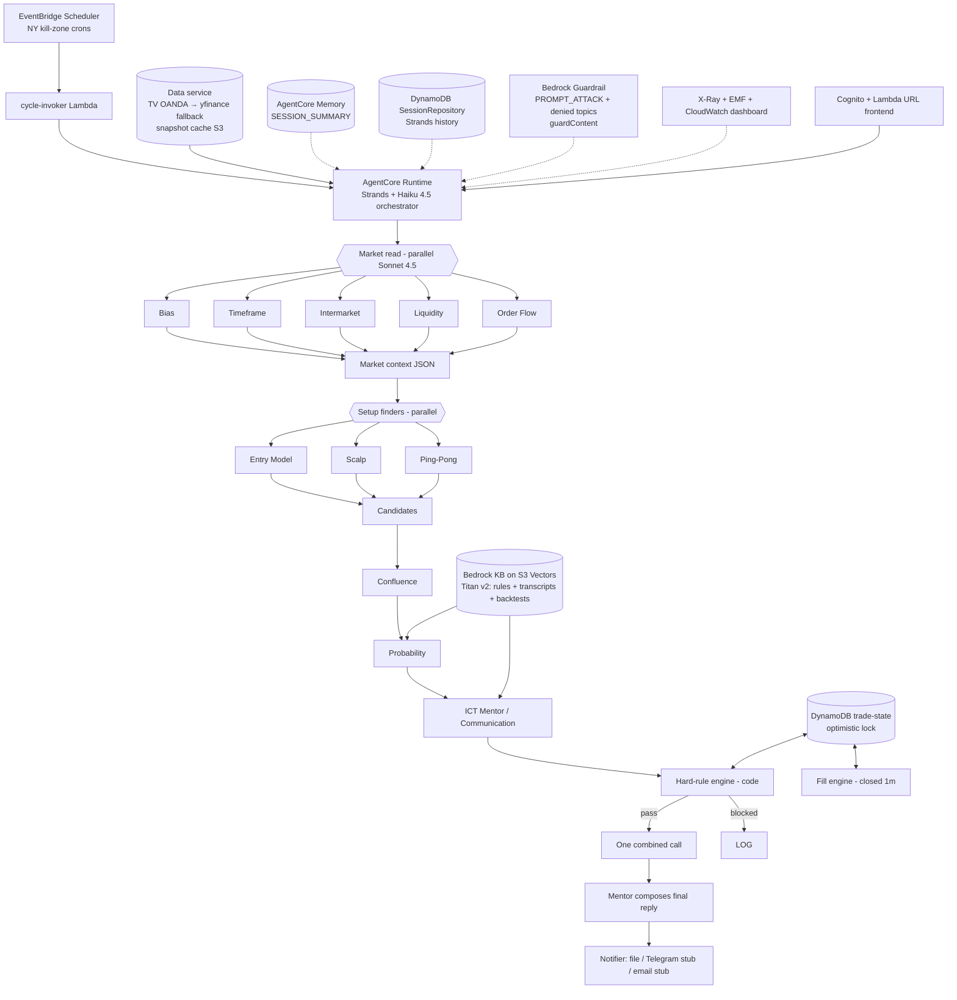

# ICT AgentCore Multi-Agent Pipeline

Analysis-and-alerts-only ICT trading pipeline on Amazon Bedrock AgentCore. Ports every
pattern from the passed Udacity / NovaMart project (`GdotAiM/novamart-agentcore-multi-agent`)
into the trading domain. **Never places trades. Not financial advice.**

Owner: configured via `OWNER_NAME` / `EQUITY` / `ALERT_CHANNEL` in `.env` (never hard-coded).
Timezone: Africa/Johannesburg (SAST). Kill zones are defined in America/New_York and converted
with `zoneinfo` (DST-safe).

## Architecture



## Course-pattern → trading-version map

| NovaMart (course) pattern | ICT trading implementation |
|---|---|
| Strands Agents on AgentCore Runtime (Haiku 4.5 orch / Sonnet 4.5 workers) | `ict_pipeline/runtime.py`, `agents/builders.py`, `agentcore/` |
| AgentCore Memory `summaryMemoryStrategy` / SESSION_SUMMARY | `ict_pipeline/memory.py`, `scripts/create_memory.py` |
| Custom Strands `SessionRepository` on DynamoDB | `ict_pipeline/sessions.py`, `tests/test_session_store.py` |
| Optimistic locking (`expected_version`) + conditional writes | `ict_pipeline/trade_state.py` (trade-state table; single writer) |
| Bedrock KB on S3 Vectors, Titan Embed Text v2 1024-d | `infrastructure/stack.yaml` + `scripts/create_knowledge_bases.py` (rules / transcripts / backtests) |
| Guardrail PROMPT_ATTACK + denied topics + PII; `guardContent` tagging; untrusted-input rule | `ict_pipeline/guardrails.py`, `scripts/create_guardrail.py`, `runtime.answer_owner` |
| Final reply always from Communication agent | `ict_pipeline/agents/mentor.py` (Mentor / Communication); orchestrator never invents fallback prose |
| Decimal + `ROUND_HALF_UP` money maths | `ict_pipeline/money.py` (R:R, size, exp R) |
| X-Ray, custom EMF metrics, CloudWatch dashboard + GetMetricWidgetImage | `ict_pipeline/observability.py`, `scripts/cloudwatch_dashboard.py` |
| Cognito user pool + Lambda function-URL proxy frontend | `scripts/create_cognito_frontend.py`, `frontend/` |
| Adversarial / injection suite | `tests/test_adversarial.py`, `scripts/adversarial_*.py` |
| moto offline tests + GitHub Actions (`checkout@v7`, `setup-python@v7`, `ubuntu-24.04`) + gitleaks | `tests/`, `.github/workflows/offline-tests.yml` |
| `.gitignore` never un-ignores `.env`; empty `aws-targets.json` | `.gitignore`, `agentcore/aws-targets.json` |
| Deploy flow (stack → seed → KB → guardrail → memory → stage → agentcore) | `scripts/deploy.py` (mirrors NovaMart; do not run without AWS creds) |

## SPEC § → code / test (rubric)

| SPEC section | Code | Test |
|---|---|---|
| 2 Architecture / envelopes | `schemas.py`, `orchestrator.py` | `test_02_*`, `test_12_*` |
| 2.1 Orchestrator / CombinedCall | `orchestrator.py`, `agents/mentor.py` | `test_12_*`, `test_15_*` |
| 2.2–2.4 Agents + checks | `agents/`, `base_rates.py` | mocked in acceptance + replay |
| 3 Hard rules (all 10) | `rules.py`, `killzones.py`, `candles.py`, `news.py`, `money.py` | `test_01`–`test_09`, `test_12` |
| 4 Data service | `data_service.py` | `test_14_*`, `test_08_*` |
| 5 Trade-state + fills | `trade_state.py`, `fills.py` | `test_trade_state.py`, `test_10_*` |
| 6 Guardrails | `guardrails.py` | `test_13_*`, `test_adversarial.py` |
| 7 Knowledge base | `scripts/create_knowledge_bases.py`, `kb/` | seed offline; live sync needs AWS |
| 8 Observability + budget | `observability.py` | `test_16_*`, `test_memory_obs.py` |
| 9 Full AWS | `infrastructure/stack.yaml`, `agentcore/`, `scripts/deploy.py` | not deployed in CI |
| 12 Acceptance (16) | — | `tests/test_acceptance.py` (all 16) |
| 14 Oct replay | `replay.py`, `tests/fixtures/replay_1m/` | `test_15_*`, `docs/S25_REPLAY.md` |

## Layout

```
ict-agentcore/
├── ict_pipeline/          # Python package (runtime, rules, agents, data, fills, …)
├── agentcore/             # AgentCore CLI project (template + empty aws-targets.json)
├── infrastructure/        # CloudFormation stack (tables, S3, S3 Vectors, IAM, EventBridge)
├── scripts/               # deploy, KB, guardrail, memory, Cognito, dashboard, adversarial, cleanup
├── frontend/              # Cognito-backed proxy UI (config.js generated, gitignored)
├── kb/                    # staged rule / backtest docs (transcripts downloaded on demand)
├── reference/             # redacted 14 Oct findings + team rules (from handover)
├── tests/                 # 16 acceptance + NovaMart-parity offline suites
├── docs/SPEC.md           # full build spec
└── .github/workflows/     # offline-tests.yml (moto + gitleaks)
```

## Setup (local / offline)

```bash
python3 -m venv .venv && . .venv/bin/activate
pip install -r requirements-dev.txt
# Optional: tvdatafeed for live primary feed / to refresh fixtures
pip install 'tvdatafeed @ git+https://github.com/rongardF/tvdatafeed'
cp .env.example .env          # set OWNER_NAME; leave EQUITY blank until you want lot sizes
pytest -q                     # 59 offline tests, no AWS / no LLM / no network send
python -m ict_pipeline.replay # full 14 Oct NY AM shadow run (NullNotifier)
python scripts/adversarial_checks.py
```

## Deploy to AWS (do this later — no credentials in this build)

Exact steps (mirrors NovaMart):

1. `aws configure` (account with Bedrock model access for Haiku 4.5 + Sonnet 4.5 + Titan Embed v2).
2. Fill `.env` from `.env.example` (`OWNER_NAME`, optional `EQUITY`, `ALERT_CHANNEL=file`).
3. `python scripts/deploy.py --step stack` — CloudFormation (`infrastructure/stack.yaml`).
4. `python scripts/deploy.py --step seed` — upload `kb/` to the KB documents bucket.
5. `python scripts/deploy.py --step kb` — create 3 Bedrock KBs on S3 Vectors (Titan v2).
6. `python scripts/deploy.py --step guardrail` — PROMPT_ATTACK + denied topics + PII.
7. `python scripts/deploy.py --step memory` — AgentCore Memory with SESSION_SUMMARY.
8. `python scripts/deploy.py --step stage` — stage `build/runtime/` + render `agentcore/agentcore.json`
   (fills local `aws-targets.json`; keep the empty committed copy).
9. Install AgentCore CLI; `python scripts/deploy.py --step agentcore` (`agentcore deploy -y`).
10. Copy runtime ARN into `.env` as `AGENTCORE_RUNTIME_ARN`.
11. `python scripts/deploy.py --step invoker` then `--step schedules` (enable EventBridge kill-zone crons).
12. `python scripts/create_cognito_frontend.py` then open `frontend/index.html`.
13. `python scripts/cloudwatch_dashboard.py --png docs/screenshots/dashboard/cloudwatch-dashboard.png`.
14. Verify: `agentcore status`; invoke a cycle; ask "why was S26 blocked?" in the frontend.
15. Cleanup: `python scripts/create_cognito_frontend.py --delete`; `python scripts/cleanup.py --yes`.

Or: `python scripts/deploy.py --all`.

## Costs (ballpark)

| Item | Notes |
|---|---|
| DynamoDB (3 tables, on-demand) | cents/day at kill-zone volume |
| S3 + S3 Vectors | storage + retrieve; Titan v2 embed on ingest |
| Bedrock Haiku 4.5 / Sonnet 4.5 | dominant cost; daily budget + 90% degradation |
| AgentCore Runtime | per-invoke |
| EventBridge Scheduler | free tier covers the kill-zone crons |
| Cognito + Lambda URL | free tier / pennies |
| X-Ray / CloudWatch | EMF + dashboard; PutMetricData |

## What is mocked vs real (offline suite)

| Component | Offline |
|---|---|
| Market data | Real 14 Oct OANDA 1m CSVs in `tests/fixtures/replay_1m/` (fetched via tvDatafeed); yfinance mocked for fallback test |
| LLM / Strands agents | `MockLLM` / `ReplayLLM` (deterministic JSON) |
| DynamoDB | moto |
| Notifier | `NullNotifier` / `FileNotifier` — **never sends** |
| Bedrock Guardrail ApplyGuardrail | light regex filter; live script is `adversarial_guardrail.py` |
| AgentCore Memory / Runtime / Cognito | helpers unit-tested; create scripts need AWS |

## Acceptance tests (SPEC §12)

All 16 live in `tests/test_acceptance.py` and pass offline. Test 10 (S25 −1R @ 14:59 SAST)
reproduces on the real OANDA 1m fixture — see `docs/S25_REPLAY.md`.

## Safety

- No broker API, no order-placement code, no trading credentials anywhere in the package
  (`tests/test_adversarial.py::test_no_broker_or_order_code_in_repo`).
- Every alert ends with `Analysis only, not financial advice.`
- Telegram / email notifiers are dry-run stubs.
- Reference files stay redacted (`[REDACTED …]`).
